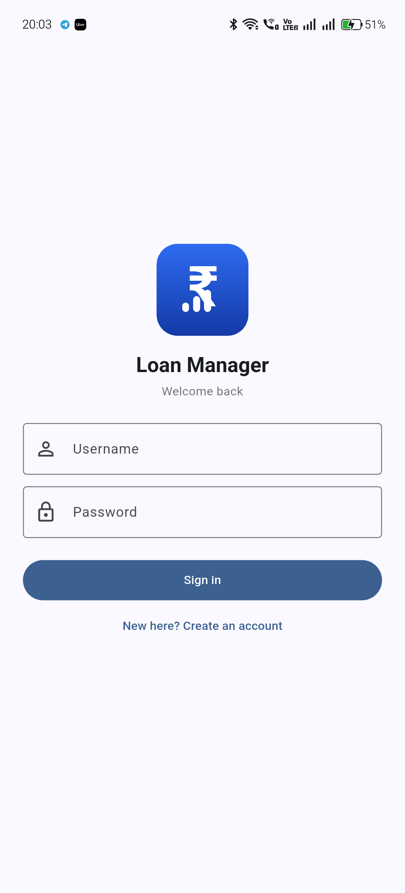

<div align="center">


# Loan Manager

**Track floating-rate loans with partial disbursements, daily interest accrual, prepayments, and interest-saved analytics — a Flutter mobile app backed by Supabase.**

[](https://flutter.dev)
[](https://dart.dev)
[](https://supabase.com)
[](#)

</div>

---

## What it does

Most EMI calculators assume a single lump-sum loan at a fixed rate. Real home loans don't work that way — money is **disbursed in stages**, the rate **floats**, interest **accrues daily**, and **prepayments** reshape the whole schedule. Loan Manager models all of that:

- **Partial disbursements** — draw down the sanctioned amount over time; interest accrues only on what's actually disbursed.
- **Daily interest accrual** — `principal × annualRate × days / 365`, computed per event, not a flat monthly approximation.
- **Prepayments** — go 100% to principal (no penalty), and the app shows exactly how much **interest** and **tenure** you saved via a with/without simulation.
- **Floating-rate changes** — update the rate and choose to keep your EMI (tenure shrinks) or keep your tenure (EMI recalculates).
- **What-if simulator** — "if I prepay ₹X today, how much do I save?" — answered with the same engine.

<div align="center">

</div>

## Features

| | |
|---|---|
| 🔐 **Username / password auth** | Supabase Auth with per-user data isolation (Row Level Security) |
| 🏦 **Multiple loans** | Dashboard with per-loan cards + combined totals across loans |
| 📊 **Unified loan view** | Sanctioned / disbursed / outstanding / accrued interest / next-due, all live |
| 💰 **Interest-saved analytics** | Simulation-based, not a rough formula |
| 📈 **Balance-over-time chart** | Outstanding principal across the timeline (fl_chart) |
| 🧮 **Amortization schedule** | Full month-by-month principal/interest/balance table |
| 🔮 **Prepayment what-if** | Instant "prepay ₹X → save ₹Y and Z months" |
| 📤 **CSV export** | Share the full timeline + summary from the device |
| ⚙️ **Rate changes** | KEEP_EMI or KEEP_TENURE floating-rate updates |

## Architecture

```
┌─────────────────────────────┐        ┌──────────────────────────────┐
│  Flutter app (on device)    │        │  Supabase                    │
│                             │        │                              │
│  loan_engine.dart  ◄────────┼── all  │  • Auth (email/username)     │
│   buildTimeline()           │  math  │  • Postgres                  │
│   simulateLoan()            │  runs  │      loans                   │
│   applyRateChange()         │  here  │      disbursements           │
│   getEmiSchedule()          │        │      payments                │
│                             │        │  • Row Level Security        │
│  screens/ • widgets/        │ ──────►│    (each user sees only      │
│  supabase_service.dart      │  data  │     their own rows)          │
└─────────────────────────────┘        └──────────────────────────────┘
```

**No custom backend server.** The financial math is pure arithmetic with no secrets, so it runs **on-device** in Dart. Supabase stores the raw data (loans, disbursements, payments); the app computes the timeline, schedule, and analytics locally. It's a faithful Dart port of a Node/Express engine — verified to reproduce identical numbers (see [Testing](#testing)).

## Tech stack

- **Flutter** (Material 3) + **Dart**
- **Supabase** — Postgres, Auth, Row Level Security
- [`supabase_flutter`](https://pub.dev/packages/supabase_flutter), [`fl_chart`](https://pub.dev/packages/fl_chart), [`share_plus`](https://pub.dev/packages/share_plus), [`path_provider`](https://pub.dev/packages/path_provider), [`intl`](https://pub.dev/packages/intl)

## Project structure

```
loan-emi-mobile/
├── lib/
│   ├── main.dart               # App entry + auth gate
│   ├── config.dart             # Supabase URL / anon key / username→email mapping
│   ├── loan_engine.dart        # THE ENGINE — timeline, simulation, rate change, schedule
│   ├── models.dart             # Supabase rows ⇄ engine inputs
│   ├── supabase_service.dart   # Auth + CRUD (replaces a REST backend)
│   ├── utils.dart              # ₹ formatting, labels
│   ├── export_csv.dart         # CSV build + share
│   ├── widgets/balance_chart.dart
│   └── screens/                # login, dashboard, new_loan, loan_timeline,
│                               #   schedule, whatif
├── test/loan_engine_test.dart  # Golden-number parity tests
├── supabase/schema.sql         # Tables + RLS policies
├── tools/                      # migrate.js, create_user.js, golden.js, make_icon.py …
└── docs/
```

## Getting started

### 1. Prerequisites
- [Flutter SDK](https://docs.flutter.dev/get-started/install) 3.44+ (`flutter doctor` all green for Android)
- A [Supabase](https://supabase.com) project (free tier is fine)
- An Android device or emulator

### 2. Set up the database
In the Supabase dashboard → **SQL Editor**, run [`supabase/schema.sql`](supabase/schema.sql). It creates `loans`, `disbursements`, `payments` and enables Row Level Security so every user sees only their own data.

### 3. Configure the app
Edit [`lib/config.dart`](lib/config.dart):
```dart
static const String supabaseUrl     = 'https://YOUR-PROJECT.supabase.co';
static const String supabaseAnonKey = 'YOUR-ANON-PUBLIC-KEY';   // safe to ship; RLS protects data
static const String authEmailDomain = 'loan.app';               // username → username@loan.app
```
> The **anon key is public by design** — Row Level Security is what protects your data. Never put the `service_role` / `sb_secret_` key in the app.

For instant username sign-up, turn **off** *Authentication → Email → Confirm email* in Supabase (it's a personal-app setting).

### 4. Run
```bash
flutter pub get
flutter test        # verify the engine reproduces the golden numbers
flutter run         # launch on your device
```

### 5. Build a release APK
```bash
flutter build apk --release
# → build/app/outputs/flutter-apk/app-release.apk
```

## Database schema

| Table | Key columns |
|---|---|
| `loans` | `user_id`, `loan_name`, `sanctioned_amount`, `rate`, `years`, `start_date`, `emi_day`, `monthly_emi` |
| `disbursements` | `loan_id`, `amount`, `date` |
| `payments` | `loan_id`, `amount`, `date`, `payment_type` (`EMI_PAYMENT` \| `PREPAYMENT`), `source_month` |

The amortization schedule, timeline, and interest-saved figures are **derived** on-device, not stored.

## Admin tools (`tools/`, Node ≥ 18)

`tools/.env` (git-ignored) holds `SB_URL`, `SB_SECRET`, and the owner credentials.

| Script | Purpose |
|---|---|
| `create_user.js <username> <password>` | Create/reset a login via the Admin API (bypasses email confirmation) |
| `migrate.js` | Import a legacy `db.json` into Supabase (idempotent) |
| `golden.js [file]` | Run the reference engine to produce golden numbers |
| `dump_sb.js` | Export current Supabase data back to `db.json` shape |
| `make_icon.py` | Regenerate the launcher/app icon |

```bash
cd tools && node --experimental-fetch create_user.js alice 'StrongPass123'
```

## Testing

The engine is a faithful port of the original Node implementation. `test/loan_engine_test.dart` asserts it reproduces **golden numbers** for a real loan — the timeline totals, the KEEP_EMI / KEEP_TENURE rate math, and the amortization schedule:

```bash
flutter test
# ✓ buildTimeline matches golden numbers
# ✓ applyRateChange parity (KEEP_TENURE / KEEP_EMI)
# ✓ getEmiSchedule parity
```

## Security

- **Row Level Security** on every table — a user can only read/write rows tied to their `auth.uid()`.
- The app ships only the **public anon key**; the `service_role` key lives in `tools/.env` and is git-ignored.
- Personal exports (`tools/db.json`, `tools/sb_dump.json`) are git-ignored so real balances never get published.

## Roadmap

- [ ] Loan editing (name / tenure / EMI day)
- [ ] Balance projection into the future
- [ ] Multi-currency & localization
- [ ] iOS build + release signing config

## Acknowledgements

Interest engine ported from a Node/Express + React reference implementation; the Dart port is verified to match it to the rupee.

<div align="center"><sub>Built with Flutter &amp; Supabase.</sub></div>
